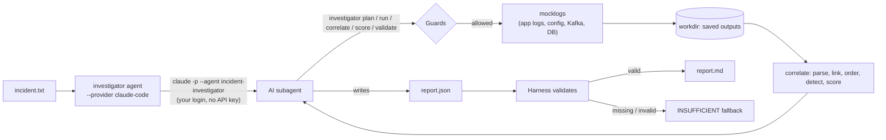

# How it works

> All data is synthetic (MOCK). Names like `order-service`, `kafka-a` or `appdb` are invented.

## 1. What the application does

When something fails in a distributed system, the error you see usually isn't where the problem started. An order times out in one service because a message was never written to Kafka, because a broker partition lost its replicas. Finding that means searching several log sources, following IDs across services, and putting events in order. This application does that investigation with an AI agent and leaves it no room to make things up.

- **Input:** an *incident*: the error line that started it (the **seed**), and where its logs live.
- **Output:** a report:
  - the root cause, or "unknown";
  - a timeline;
  - evidence, where every claim cites an event ID;
  - rejected or open alternatives;
  - coverage gaps;
  - a confidence level;
  - next steps.

The split of work, decided in D31: **the AI investigates, the code guards.**

| The AI decides | The code guarantees |
|---|---|
| What to fetch, beyond the suggested starting set | Every command is checked against an allowlist and the incident before it runs |
| Which leads matter, and when to dig further | Logs are parsed, linked by IDs and ordered the same way every time |
| What the root cause is, or that it's unknown | A proposed cause is scored: the confidence **ceiling** is computed, not guessed |
| How to explain it | The report is validated: invented IDs, over-claimed confidence or hidden gaps are rejected |

## 2. Two ways to run the agent

Both paths give the AI the same skills, go through the same `investigator` code and guards, and end with the same validator. What differs is **who owns the agent loop**: the code that repeatedly sends the conversation to the model, runs the tool it asks for, and returns the result.

| | **Claude Code** (`--provider claude-code`) | **Python agent loop** (`--provider fake`) |
|---|---|---|
| Who runs the loop | Claude Code, running the `incident-investigator` subagent headless | This app (`src/investigator/agent/loop.py`) |
| The AI's tools | General-purpose: Bash, Read, Write, narrowed by permissions and a hook to `investigator …` commands and the workdir | 5 typed functions: `plan`, `run`, `correlate`, `score`, `submit_report`. No shell or file access exists. |
| Model access | Your Claude login (no API key) | A provider interface. Today only a scripted model implements it; a real one needs an API key (deferred, D10/D11). |
| Report | The agent writes `report.json`; the harness validates it afterwards | `submit_report` is validated on each call, up to 3 attempts |
| Status | **Working**: all 4 scenarios run live (`runs/`) | Built and tested end to end with the scripted model |
| Role | The working path: an engineer runs it from the command line | How it would be built as a **service**: the app controls the tools, turn budget, context and cost |

**Why keep both.** Claude Code was the fastest way to get a real model investigating on a subscription, and skills as plain files are easy to show and change. The agent loop is the usual shape of an AI product, where the app calls a model API with tools it defines, and it is safe by construction rather than by restriction. Adding a real model there means writing one provider class (`agent/provider.py`). Nothing else changes.

## 3. The big picture (Claude Code path)



## 4. Inputs

### The incident

```
INCIDENT
seed: {"ts":"2026-03-14T09:04:50.050Z","level":"ERROR","app":"order-service","correlation_id":"c-325b56",
       "order_id":"o-1008","msg":"Timed out waiting for pricing event", ...}
app:    cluster=cluster-a namespace=apps
app[product-service]: cluster=cluster-a namespace=apps
kafka:  bootstrap=kafka-a:9092 topics=pricing.events,orders.events group=order-service-pricing
db:     host=db-a name=appdb
```

- **The incident says *where*.** These are the clusters, Kafka bootstrap, topics and database. **No input, no access** (D22): a source the incident doesn't name is never searched, and the report records it as a gap.
- **The seed app's config says *who*** (D26, D27): the apps upstream and downstream of it, and its Kafka client IDs. An app counts as related only if the config names it.

### Which ID to follow

- **The correlation ID** works only inside one app (D25).
- **Across services, the agent follows a business key** chosen by the seed's class: `Order*` → `order_id`, `Product*` → `product_id`. The coordinator skill holds this table.
- **Within one app:** one request is also followed along its thread, for up to 1 minute (D17).

## 5. The components

| Part | Where | What it does |
|---|---|---|
| **Mock systems** | `src/mocklogs/` | Command-line tools (`mocklogs kubectl …`, `mocklogs kafka …`, `mocklogs db …`) that serve synthetic logs for 4 scenarios. They need an SSO login (`mocklogs sso login`), as the real tools would. The agent can't run the login. |
| **Skills** | `.claude/skills/` | Instructions for the AI. There's one coordinator (`incident-logs`: rules, incident format, ID table, the investigation procedure, the report contract). There's also one skill per source (`incident-app-logs`, `incident-app-config`, `incident-kafka`, `incident-db-logs`): how to log in, required inputs, commands, output format, what counts as an error, and an **allowlist** of permitted commands. |
| **Subagent** | `.claude/agents/incident-investigator.md` | The Claude Code agent: all 5 skills preloaded, tools limited to Bash, Read and Write, at most 60 turns. |
| **Investigator** | `src/investigator/` | The deterministic engine and the agent's only interface to the data (the `investigator` command). It never imports the mock package, and contains no scenario names (a test enforces both). |
| **Harness (Claude Code path)** | `src/investigator/agent/claude_code.py` | Starts Claude Code headless with the limits in §10, records the run, and validates the result. |
| **Agent loop (service path)** | `src/investigator/agent/loop.py`, `tools.py`, `provider.py`, `narration.py`, `fake.py` | The app's own loop: 5 typed tools over the same guarded code, a compact view of the evidence for the model's context, a turn budget, 3 report attempts, and the fallback. `fake.py` is the scripted model that drives it today. |

### `investigator` commands (what the agent runs)

| Command | Purpose |
|---|---|
| `init` | Validate the incident and save it verbatim into the workdir. |
| `plan` | **Suggest** the next fetches, each with a reason, and list known gaps. These are suggestions, not orders. |
| `run --reason "…" -- mocklogs …` | The **only** way to fetch. Checks the command, runs it without a shell, saves the output, and logs it to `actions.jsonl`. |
| `check -- mocklogs …` | Ask whether a command would be allowed, without running it. |
| `correlate` | Analyse everything collected so far: the timeline, links, detector findings, leads with confidence factors, gaps, and unexplained errors. |
| `score --cause <event_id>` | Score **any** cause the AI proposes and return its confidence ceiling. |
| `validate --report …` | Check the report against the evidence. |
| `render --report …` | Turn a validated report into Markdown. |

## 6. The investigation, step by step

This follows the coordinator skill's §6 and is the same on both paths. On the agent loop, the steps are tool calls instead of commands.

1. **Collect broadly.**
   - The agent runs `plan` and executes each suggestion through `run`, repeating until `plan` says it's done.
   - The suggestions cover:
     - the seed app's logs, by correlation ID and by thread;
     - its config;
     - Kafka: messages, producer, consumer and broker logs for each topic, plus its own client IDs;
     - the related apps, by business key and their client IDs;
     - database sessions.
   - For Kafka, "collect" means incoming messages, outgoing messages, retries, and topic errors or timeouts (D28).
2. **Assess.** `correlate` turns the saved outputs into one picture, as described in §7.
3. **Dig where it's thin.** The agent may fetch beyond the suggestions: a wider window, another partition, an ID it found. Each fetch is still checked.
4. **Decide.** The agent proposes a cause, or "unknown", and runs `score` on it. It may claim **at most** that ceiling, and can choose less. In the live run of scenario 2, the AI chose MEDIUM under a HIGH ceiling because one alternative was still open.
5. **Report.** It writes `report.json`, runs `validate`, and fixes errors, with up to 3 attempts.

## 7. Inside `correlate` (deterministic)

1. **Parse.** Each source has its own parser: JSON app logs, config, Kafka messages and client/broker logs, and DB logs. Every line becomes an **Event** with a stable ID (`ev-…`), a UTC time, the IDs on it, and its business keys. Unparseable lines are kept as parse issues, never dropped silently.
2. **Classify.** Each event is marked ERROR, SYMPTOM, CONTEXT or ANOMALY, with an error code, using per-source rule tables. For example, Kafka `REQUEST_TIMED_OUT` and a DB `too many clients` count as errors.
3. **Link.** Events are joined into groups (union-find) by:
   - `EXACT_ID`: the same correlation ID within one app (never across apps, D25);
   - `SAME_OCCURRENCE`: one Kafka client line seen twice (in the app's logs and in `kafka logs`), within 2 s; counted once;
   - `BUSINESS_KEY`: the same business key (e.g. `order_id`) across apps, Kafka and the DB, within −10 min / +2 min of the seed;
   - `THREAD_LOCAL`: the same thread segment;
   - `RESOURCE`: two log records naming the same topic-partition.
4. **Order.** A single timeline sorted by UTC time. Clock skew is deliberately ignored, because the windows are large (D30).
5. **Detect.** Detectors produce **findings**:

   | Detector | What it looks for |
   |---|---|
   | D-1 `retry_exhaustion` | Retries that ran out |
   | D-2 `delivery_failure_chain` | A send that failed end to end |
   | D-3 `missing_message` | An expected message that's absent from every partition |
   | D-4 `poison_message` | The same record failing again and again |
   | D-5 `db_error_burst` | A burst of DB errors |
   | D-6 `config_vs_observed` | Config that contradicts what the logs show, such as a pool size against a thread count |
   | D-7 `first_error_per_app` | The first error per app (informational only) |

6. **Hypotheses (leads).** Findings that share events become a chain, and each chain gets a candidate cause. These are **leads for the AI**, not answers.

## 8. Confidence: computed, not felt

Every proposed cause gets four factors, each STRONG, PARTIAL, WEAK or ABSENT:

| Factor | Question it answers |
|---|---|
| `id_linkage` | Is the cause linked to the seed by IDs, the business key or a topic-partition, or only close in time? |
| `traversal_coverage` | Were the sources that matter actually searched, or are there gaps? |
| `temporal_precedence` | Does the cause come before the effects and the seed? |
| `competing_hypotheses` | Is there another lead that's just as strong? |

They combine into the **ceiling**:

| If… | the ceiling is |
|---|---|
| linkage, precedence or coverage is ABSENT | INSUFFICIENT |
| any factor is WEAK | LOW |
| any factor is PARTIAL | MEDIUM |
| all are STRONG | HIGH |

## 9. The report and its validation

The report contract is in coordinator §7: summary, the seed's correlation ID, timeline, root cause (or `"unknown"`), evidence, downstream symptoms, alternative hypotheses, confidence with factors, gaps, AI interpretations, and next steps.

The validator rejects a report that:

| Code | Means |
|---|---|
| `unknown_event_id` | it cites an event that was never collected (an invented ID) |
| `root_cause_no_evidence` | it names a cause without evidence |
| `confidence_above_ceiling` | it claims more confidence than `score` allows |
| `factors_mismatch` | it reports factor values different from the scored ones |
| `unknown_root_cause_confident` / `insufficient_with_cause` | "unknown" isn't INSUFFICIENT, or a named cause is |
| `gap_not_acknowledged` | it leaves out a coverage gap |
| `wrong_correlation_id` | it uses a correlation ID that isn't the seed's |
| `timeline_out_of_order` | its timeline isn't in time order |
| `missing_section` / `bad_value` | a section is missing or malformed |

The harness runs this validation itself on the final `report.json`, whatever the agent says. **If the report is missing or still invalid, it is not trusted.** It is kept as `report.rejected.json`, and the result becomes an **INSUFFICIENT fallback** report built from the evidence alone.

## 10. Guardrails (defence in depth)

| Layer | Stops |
|---|---|
| **Claude Code permissions** (`--permission-mode dontAsk`) | Anything not pre-approved. Allowed: `investigator <subcommand>` for the 8 subcommands above, and file edits inside the workdir. Denied: `investigator agent` (nested runs) and reading the repo's `src/`, `tests/`, `docs/` and `runs/`, which contain the mock scenarios and their answers. User settings and MCP servers aren't loaded, so they can't widen this. |
| **PreToolUse hook** (`.claude/hooks/allowlist_guard.py`) | Bash commands that aren't one plain `investigator` command, and any shell operator (`&&`, `;`, pipes, redirects, `$( )`). The model is told why. This is strict: in one live run it blocked a `;` inside a quoted reason, and the agent rephrased. |
| **`investigator run` guard** | `mocklogs` commands that aren't in a skill's allowlist, or that target a cluster, topic, database or app the incident and config don't provide. Every attempt is logged. |
| **Mock SSO** | Fetches without a login. The agent can't log in; it has to ask you. |
| **Report validator + fallback** | Invented evidence, over-claimed confidence, hidden gaps. |
| **Login, not a key** | `ANTHROPIC_API_KEY` / `ANTHROPIC_AUTH_TOKEN` are removed from the environment, so the run uses your Claude login. |

On the **agent loop** path, the first two layers aren't needed: the model has no shell and no file access, only the 5 typed tools, which call the same `investigator run` guard and validator.

Rate limiting and further safeguards are planned separately (D24).

## 11. What a run leaves behind

| File | Content |
|---|---|
| `<workdir>/incident.txt` | The incident, verbatim |
| `<workdir>/…` (saved outputs) | Every fetched output, as returned |
| `<workdir>/actions.jsonl` | Every command the agent tried: allowed or denied, its reason, and its exit code |
| `<workdir>/report.json`, `report.md` | The final, validated report |
| `<workdir>/report.rejected.json` | Only if the agent's report failed validation |
| `runs/<timestamp>-<label>.jsonl` | The full transcript: every message and tool call from Claude Code. Kept permanently. |

## 12. The four mock scenarios

| Scenario | The seed | Live result |
|---|---|---|
| `upstream-timeout` | order-service times out waiting for a pricing event | HIGH: a Kafka partition lost replicas, so the upstream's sends expired |
| `db-config` | fulfillment-worker can't get a DB connection | MEDIUM: the pool is too small for the thread count (another cause is still open) |
| `consumer-processing` | notification-worker times out waiting for a fulfillment event | HIGH: a poison message blocks the upstream consumer |
| `ambiguous` | the edge gateway returns 502, with no IDs | INSUFFICIENT: the config was denied, and nothing explains it |

The code never hardcodes a cause for a scenario. Robustness tests (`tests/robustness/`) run every scenario with each of these changes:
- every name renamed;
- times shifted;
- lines shuffled;
- 30% of lines dropped;
- duplicates added;
- malformed lines added;
- all the noise combined.

The detectors, the kind of cause and the confidence ceiling must stay the same. Access denials may only lower confidence.

## 13. Testing

```bash
.venv/bin/pytest -q
```

- The suite covers parsers, linking, detectors, scoring, the guards, the hook and the validator.
- It also runs end to end: through the Python agent loop with a scripted model, and through the Claude Code harness with a **fake `claude` executable** that sends commands through the real hook. Neither uses your Claude account.
- Live runs on the real Claude Code are in `runs/`, documented in `runs/README.md`.
